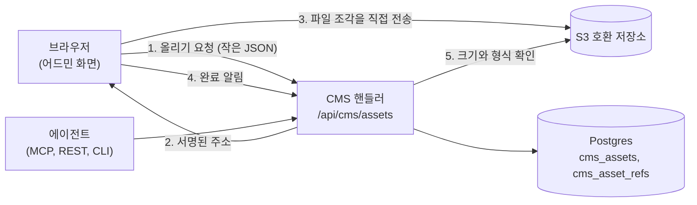
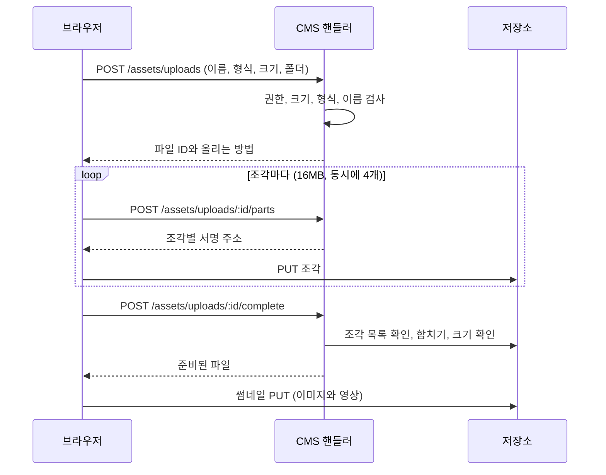

# 미디어 라이브러리와 파일 저장소 (0.8.0)

## 1. 왜 하는가

agent-cms 0.7.0은 글과 값만 저장한다. 파일 업로드, 저장소 연동, 본문 이미지 문법이 모두 없다 (`src/markdown.ts`에 이미지 문법 없음, 필드 위젯 9종에 이미지와 파일 없음, 요청 본문 한도 512KB). Payload, Directus, Strapi, Sanity는 모두 미디어를 기본으로 갖고 있어서, CMS라고 부르기에 가장 큰 빈자리다.

0.8.0은 **미디어 라이브러리**를 만든다. 0.9.0의 **버킷 파일 관리자**가 그 위에 그대로 얹히도록 데이터 구조를 지금 정한다.

화면 시안 (v1 승인됨, 2026-11-19):

[미디어 라이브러리와 파일 관리자](../../.slash/workspace/mockups/media-library/mockup.json#v1)

## 2. 정해진 것 (인터뷰 답)

| 항목 | 결정 |
|---|---|
| 범위 | 0.8.0 미디어 라이브러리, 0.9.0 파일 관리자 |
| 저장소 | S3 호환 먼저 (AWS S3, Cloudflare R2, MinIO). Vercel Blob은 0.9.0 |
| 파일 관리자의 대상 | 버킷 전체 (CMS로 올리지 않은 파일 포함) |
| 공개와 비공개 | 0.8.0부터 둘 다. 비공개 파일은 권한 확인 뒤 잠깐만 유효한 주소로 연다 |
| 비공개 열람 규칙 | 저장소마다 앱이 정한다. 기본은 로그인한 사람과 유효한 키 |
| 파일 종류와 크기 | 영상과 대용량 포함. 기본 최대 5GB, 설정으로 변경 |
| 허용 형식 | 개발자가 정한다. 앱 전체, 저장소별, 필드별 세 단계이고 좁은 쪽 설정이 우선한다. 아무것도 정하지 않으면 안전한 기본 목록을 쓴다 (4.5.1절) |
| 이미지 변환 | 원본만 저장. 브라우저가 썸네일 1장을 함께 올리고, 공개 화면용 크기는 앱이 정하는 변환 주소 연결구로. 서버 변환 모듈은 0.9.0 이후 선택 기능 |
| 정리 방식 | 폴더와 태그 |
| 사용 중인 파일 삭제 | 사용하는 문서 목록을 보여 주고 확인받는다 |
| 대체 텍스트 | 없으면 경고. 컬렉션 설정으로 필수로 바꿀 수 있다 |
| 에이전트 권한 | write 키는 조회, 가져오기, 설명 작성. 이동과 삭제는 publish 권한 키 |
| 검증 대상 | 로컬 MinIO. R2와 AWS S3는 설정 예시만 싣고 사용자가 `storage check`로 확인 |
| 모델을 부르는 기능 | 이 패키지에 넣지 않는다 (2026-11-20). 도구를 밖으로 내기만 한다: MCP, REST, CLI, `./tools`. 지금 있는 `./ai` 입구는 0.8.0의 첫 작업으로 뺀다 (4.11절) |

## 3. 하지 않는 것 (0.8.0)

- 버킷 전체 탐색, 공유 링크 만들기, 파일 여러 개 한꺼번에 이동 (0.9.0, 시안 8번 화면)
- Vercel Blob (0.9.0)
- 서버에서 이미지 크기 바꾸기, 자르기, 초점 지정
- 파일 휴지통. 삭제는 바로 지워진다 (로드맵 2번 묶음의 휴지통에서 함께 다룬다)
- 같은 주소를 유지한 채 파일 교체
- 이미지 여러 장을 담는 필드 (갤러리)
- 페이지를 새로 고친 뒤 올리기 이어 하기 (같은 화면 안에서의 재시도는 지원)
- 바이러스 검사
- 모델을 부르는 기능 전부 (예: 이미지를 보고 대체 텍스트 만들기). 이 패키지는 모델과 키를 갖지 않는다. 그런 기능은 확장 패키지가 확장 자리에 붙인다 (4.11절)

## 4. 설계

### 4.1 구조



파일은 서버를 거치지 않고 브라우저에서 저장소로 바로 간다. 그래서 Vercel의 서버 업로드 한도(4.5MB)나 지금의 512KB 본문 한도와 상관없이 5GB까지 올릴 수 있다. 서버가 파일을 직접 받는 경우는 에이전트의 URL 가져오기 하나뿐이다.

### 4.2 설정

```ts
import { createCms } from "@mainsoft/agent-cms";
import { s3Storage } from "@mainsoft/agent-cms/storage-s3";

export const cms = createCms({
  repo,
  collections,
  media: {
    stores: {
      public: {
        label: "공개",
        visibility: "public",
        adapter: s3Storage({ bucket: "example-public", region: "auto", endpoint: process.env.S3_ENDPOINT, accessKeyId: process.env.S3_KEY!, secretAccessKey: process.env.S3_SECRET! }),
        publicUrl: "https://cdn.example.com",
      },
      private: {
        label: "비공개",
        visibility: "private",
        adapter: s3Storage({ bucket: "example-private", /* ... */ }),
        // access: { read: ({ actor }) => actor.kind === "user" },
        // accept: [...DEFAULT_ACCEPT, ".html"], // 이 저장소만 다르게
        // maxFileSize: 20 * 1024 ** 3,          // 이 저장소만 다르게
      },
    },
    maxFileSize: 5 * 1024 ** 3, // 기본값
    // accept: ["image/*", "video/*", "application/pdf"], // 앱 전체. 생략하면 DEFAULT_ACCEPT
    // imageUrl: ({ url, width }) => `/_next/image?url=${encodeURIComponent(url)}&w=${width}&q=75`,
  },
});
```

- `media`를 설정하지 않으면 기능 전체가 꺼진다. 메뉴가 보이지 않고 경로는 `media_disabled` 오류를 낸다.
- 저장소는 여러 개 둘 수 있다. 시안의 "공개", "비공개"는 저장소의 `label`이다.
- 저장소 하나는 버킷 하나, 또는 버킷 안의 `prefix` 하나다.

### 4.3 데이터

테이블 2개를 추가하고 `SCHEMA_VERSION`을 3으로 올린다. 같은 단계에서 "사람을 대신한 에이전트" 열 3개도 넣는다 (4.11절).

**`cms_assets`**

| 열 | 뜻 |
|---|---|
| `id` | 짧은 무작위 ID (소문자와 숫자 12자). 문서는 이 ID로 파일을 가리킨다 |
| `store`, `key` | 저장소 이름과 저장소 안의 경로. 둘을 합쳐 유일 |
| `folder`, `name` | 경로를 폴더와 파일 이름으로 나눈 값 (목록 조회용) |
| `kind` | `image`, `video`, `audio`, `document`, `other`, `folder` |
| `mime`, `size`, `width`, `height`, `duration` | 형식, 크기, 가로세로, 재생 시간 |
| `alt`, `tags` | 대체 텍스트, 태그 |
| `thumb_key` | 썸네일의 경로 (없을 수 있음) |
| `status`, `upload_id` | `pending`(올리는 중) 또는 `ready`, 조각 올리기 식별자 |
| `created_by*`, `created_at`, `updated_at` | 올린 사람과 시각 |

**`cms_asset_refs`**: `asset_id`, `document_id`, `in_draft`, `in_published`. 문서를 저장하거나 게시할 때 같은 트랜잭션에서 다시 계산한다. 시안의 "사용처"와 삭제 확인 창이 이 표를 읽는다. 문서나 파일이 지워지면 함께 지워진다.

**0.9.0을 위해 지금 정하는 것**

- 저장소 안의 경로는 사람이 읽는 그대로다: `blog/launch-hero.jpg`. 미디어 화면의 폴더가 곧 버킷의 폴더다. 그래야 파일 관리자가 버킷을 그대로 보여 줄 수 있다.
- 문서는 경로가 아니라 ID로 파일을 가리킨다. 그래서 파일을 옮기거나 이름을 바꿔도 문서가 깨지지 않는다.
- 연결 규격에 `list`를 처음부터 넣는다. 0.9.0에서 CMS가 모르는 파일은 `(store, key)`로 행을 하나 넣는 것만으로 등록된다.
- 썸네일은 예약된 경로 `_cms/thumbs/<id>.webp`에 둔다. 파일 관리자는 `_cms/`를 숨긴다.
- 빈 폴더는 S3 콘솔과 같은 방식으로 `경로/` 표시 객체를 만들고 `kind: "folder"` 행으로 기록한다.

같은 폴더에 같은 이름이 있으면 덮어쓰지 않고 `launch-hero-2.jpg`처럼 번호를 붙인다. 파일 이름은 한글을 그대로 두되 제어 문자, `/`, `\`, 앞머리 점을 없애고 200자로 자른다.

### 4.4 저장소 연결 규격

`src/storage.ts`의 `StorageAdapter`:

| 메서드 | 용도 |
|---|---|
| `presignPut`, `put` | 한 번에 올리기 (브라우저용 서명 주소, 서버용 직접 전송) |
| `createMultipart`, `presignPart`, `listParts`, `completeMultipart`, `abortMultipart` | 조각으로 나눠 올리기 |
| `head` | 올라간 파일의 실제 크기와 형식 확인 |
| `presignGet`, `publicUrl` | 비공개 파일의 잠깐 유효한 주소, 공개 주소 |
| `copy`, `delete` | 이동(복사 후 삭제), 삭제 |
| `list` | 폴더 단위 목록 (0.9.0 파일 관리자, `storage check`) |

- `MemoryStorage`: 테스트용. 같은 계약 테스트를 `MemoryStorage`와 MinIO 양쪽에 돌린다.
- `s3Storage` (`src/storage-s3.ts`): 서명은 `aws4fetch`(1.0.20, 의존성 없음)를 쓴다. AWS SDK는 의존성이 많아 쓰지 않는다. S3의 XML 응답 4종(목록, 조각 시작, 조각 목록, 완료)은 직접 읽는다.
- 0.9.0의 Vercel Blob은 브라우저 올리기 방식이 서명 주소가 아니라 토큰 교환이다. 그래서 서버가 브라우저에 돌려주는 "올리는 방법"을 `{ kind: "single" | "multipart" | ... }` 형태로 열어 둔다.

### 4.5 올리기 흐름



- 16MB 이하는 한 번에, 그보다 크면 16MB 조각으로 나눈다 (5GB는 320조각). 조각 크기는 모두 같게 한다 (R2의 조건).
- 조각이 실패하면 3번까지 자동으로 다시 보내고, 그래도 안 되면 시안 3번의 "다시 시도"가 남은 조각만 이어서 올린다.
- 완료할 때 서버가 저장소에 조각 목록을 직접 물어본다. 버킷 CORS에 `ETag` 노출 설정이 없어도 동작한다.
- 완료 뒤 서버가 실제 크기를 확인한다. 신고한 크기와 다르거나 한도를 넘으면 지우고 오류를 낸다.
- 썸네일은 브라우저가 만든다: 이미지는 긴 쪽 480px WebP, 영상은 1초 지점 화면. 만들지 못하면 생략한다.
- 가로세로와 재생 시간은 브라우저가 읽어 보낸다. 에이전트가 가져온 이미지는 서버가 파일 머리 부분에서 읽는다 (`src/image-meta.ts`, PNG, JPEG, GIF, WebP).
- 올리다 만 파일(`pending`)은 `cms.assets.cleanup()`과 `agent-cms storage cleanup`이 24시간 뒤 지운다. `doctor`가 개수를 알려 준다.

### 4.5.1 허용 형식 (개발자 옵션)

어떤 파일을 받을지는 개발자가 정한다. 세 단계가 있고, 좁은 쪽 설정이 우선한다.

| 단계 | 쓰는 곳 | 뜻 |
|---|---|---|
| 앱 전체 | `media.accept` | 모든 저장소의 기본값. 생략하면 `DEFAULT_ACCEPT` |
| 저장소별 | `media.stores.<이름>.accept` | 그 저장소에서는 앱 전체 값 대신 이 값을 쓴다 (더 넓게도, 더 좁게도 가능) |
| 필드별 | `admin.fields.<필드>.accept` | 그 필드에 넣을 수 있는 파일. 저장소 규칙을 통과한 파일 중에서 다시 거른다 |

```ts
import { DEFAULT_ACCEPT } from "@mainsoft/agent-cms/storage";

media: {
  accept: ["image/*", "application/pdf"],            // 앱 전체
  stores: {
    private: { /* ... */ accept: [...DEFAULT_ACCEPT, ".html"] }, // 저장소별
  },
}

defineCollection({
  fields: z.object({ cover: assetId().optional(), contract: assetId().optional() }),
  admin: { fields: {
    cover: { widget: "image", accept: ["image/png", "image/jpeg", "image/webp"] }, // 필드별
    contract: { widget: "file", accept: [".pdf"], store: "private" },
  } },
});
```

- **적는 법**: MIME(`image/png`), 묶음(`image/*`), 확장자(`.pdf`) 세 가지를 섞어 쓴다. `["*/*"]`는 전부 허용이다.
- **기본 목록 `DEFAULT_ACCEPT`** (아무것도 정하지 않았을 때): 이미지(JPEG, PNG, WebP, GIF, AVIF, SVG), 영상(MP4, WebM, MOV), 소리(MP3, WAV, M4A), PDF, 오피스 문서(DOCX, XLSX, PPTX), 텍스트(TXT, CSV, MD), ZIP. HTML, 스크립트, 실행 파일은 들어 있지 않다. 개발자가 직접 적으면 받을 수 있다. 목록을 내보내서 `[...DEFAULT_ACCEPT, ".html"]`처럼 덧붙여 쓸 수 있게 한다.
- **최대 크기도 같은 방식**: `media.maxFileSize`(앱 전체), `stores.<이름>.maxFileSize`(저장소별), `admin.fields.<필드>.maxFileSize`(필드별).
- **검사는 세 번** 한다. 브라우저의 파일 선택 창을 믿지 않는다.
  1. 올리기 요청 때: 파일 이름의 확장자와 신고한 형식이 둘 다 허용 목록에 맞는지, 서로 어긋나지 않는지 (`photo.png`인데 `text/html`이면 거절).
  2. 올리기 완료 때: 서버가 파일의 첫 4KB를 읽어 실제 형식을 확인한다 (이미지, PDF, ZIP 계열, MP4 계열처럼 머리 부분으로 알 수 있는 형식). 어긋나면 파일을 지우고 오류를 낸다.
  3. 필드에 넣을 때: 문서 진단이 `asset_wrong_kind`로 잡는다 (저장과 게시 모두).
- **오류 코드**: `asset_type_not_allowed`(params: `name`, `mime`, `allowed`), `asset_type_mismatch`, `asset_too_large`(params: `size`, `max`). 영어와 한국어 문구를 카탈로그에 넣는다.
- **에이전트와 CLI도 같은 규칙**: `import_asset`, `agent-cms upload`가 같은 검사를 거친다.
- **화면**: 파일 선택 창의 `accept` 속성과 끌어다 놓기 검사를 실제 규칙에서 만든다. `GET /_me`의 `media.stores[].accept`와 `_schema`의 필드 `accept`로 내려 준다. 미디어 선택 창은 필드 규칙에 맞지 않는 파일을 고를 수 없게 흐리게 보여 준다. 거절된 파일은 시안 3번의 실패 줄 자리에 오류 문구와 함께 나온다 (문구는 9절 참고).
- **어떻게 열리는가**: 이미지, 영상, 소리, PDF가 아닌 파일은 개발자가 허용했더라도 브라우저에서 열리지 않고 내려받아지도록 저장한다 (`Content-Disposition: attachment`). HTML을 허용해도 앱 도메인에서 실행되지 않게 하기 위해서다.
- `agent-cms storage check`가 저장소마다 실제로 적용되는 허용 형식과 최대 크기를 출력한다.

### 4.6 문서에 넣기

**본문 문법** (`src/markdown.ts`)

| 쓰는 법 | 결과 |
|---|---|
| `` 한 줄 | 이미지 블록. 영상 파일이면 재생기, 그 밖의 파일이면 내려받기 카드 |
| `` | 외부 이미지 (https만). `TODO.md` 44번을 여기서 함께 처리 |
| `[라벨](asset:ID/이름.pdf)` | 파일로 가는 링크 |

- `ID/` 뒤의 이름은 읽기 편하라고 붙이는 것이고, 실제로는 ID만 본다.
- `Block`에 `media`, `Inline`에 `image`를 추가한다. 검색용 `plainText()`는 대체 텍스트와 캡션을 포함한다.
- 본문에 대체 텍스트가 비어 있으면 파일에 적어 둔 대체 텍스트를 쓴다.
- 앱의 공개 화면은 `cms.assetsFor(doc)`로 문서가 쓰는 파일의 주소, 가로세로, 대체 텍스트를 한 번에 받는다. 크기 변환 주소는 `cms.imageUrl(asset, { width })`.

**필드**: `admin.fields`의 `widget`에 `"image"`, `"file"`을 추가한다. 값은 파일 ID 문자열이고 zod 도우미 `assetId()`를 제공한다 (시안 5번의 Cover). 필드마다 `accept`(허용 형식), `maxFileSize`, `store`(어느 저장소에서 고르고 올릴지)를 줄 수 있다. `widget: "image"`의 기본 `accept`는 `["image/*"]`이다.

**진단** (`diagnose`, 저장, 게시가 함께 쓴다)

| 코드 | 수준 | 뜻 |
|---|---|---|
| `asset_missing` | 오류 | 없는 파일이거나 아직 올리는 중 |
| `asset_wrong_kind` | 오류 | 필드의 허용 형식에 맞지 않는 파일 (예: 이미지 필드에 PDF) |
| `asset_alt_missing` | 경고 | 대체 텍스트가 본문에도 파일에도 없음. 컬렉션의 `media: { requireAlt: true }`면 오류 |
| `asset_private_in_public` | 경고 | 공개 컬렉션 문서가 비공개 파일을 씀 (방문자에게 보이지 않음) |

파일이 있는지 확인하려면 DB를 읽어야 한다. 지금 `check()`는 동기 함수라서, 그 뒤에 비동기 파일 검사 단계를 추가하고 `create`, `write`, `patch`, `diagnose` 경로가 모두 거치게 한다.

### 4.7 권한

| 동작 | 사람 (기본) | API 키 |
|---|---|---|
| 목록과 정보 보기 | 로그인한 사람 | read 이상 |
| 올리기, URL에서 가져오기, 대체 텍스트와 태그 수정, 새 폴더 | 관리자 | write 이상 |
| 이동, 이름 변경, 삭제 | 관리자 | publish 이상 |
| 비공개 파일 열기 | 로그인한 사람 | 유효한 키 |

- 저장소마다 `access: { read, write, delete }` 함수로 바꿀 수 있다 (컬렉션의 `access`와 같은 방식).
- 비공개 파일의 주소는 `/api/cms/files/<id>/<이름>`이다. 권한을 확인한 뒤 5분짜리 서명 주소로 넘긴다 (`linkTtlSeconds`로 변경). 공개 파일도 같은 주소로 열 수 있고, 그때는 공개 주소로 넘긴다.
- "주소 복사"는 공개 파일이면 공개 주소를, 비공개 파일이면 위의 주소를 복사한다.
- 감사 로그에 `asset.upload`, `asset.move`, `asset.delete`를 추가한다. 권한 실패는 기존 `access.denied`로 남긴다.

### 4.8 REST 경로

| 경로 | 용도 |
|---|---|
| `GET /assets` | 목록 (`store`, `folder`, `kind`, `q`, `tag`, `cursor`) |
| `GET /assets/_folders`, `POST /assets/_folders`, `DELETE /assets/_folders` | 폴더 트리와 개수, 새 폴더, 빈 폴더 삭제 |
| `POST /assets/uploads`, `GET`과 `DELETE /assets/uploads/:id`, `POST .../parts`, `POST .../complete` | 올리기 |
| `POST /assets/:id/thumb` | 썸네일 올릴 주소 |
| `POST /assets/_import` | URL에서 가져오기 |
| `GET /assets/:id`, `PATCH /assets/:id`, `POST /assets/:id/move`, `DELETE /assets/:id` | 정보와 사용처, 수정, 이동, 삭제 |
| `GET /files/:id/:name` | 파일 열기 (`?thumb=1`, `?download=1`) |

- 사용 중인 파일을 `DELETE`하면 `asset_in_use`(409)와 사용 문서 목록을 돌려준다. `?confirm=1`이면 지운다.
- `GET /_me`에 `media`(저장소 목록, 최대 크기, 허용 형식, 내 권한)를 추가한다.
- `createRestClient`에 같은 이름의 메서드를 추가한다.

### 4.9 에이전트

도구 6개를 추가한다 (16개에서 22개).

| 도구 | 필요 권한 | 하는 일 |
|---|---|---|
| `list_assets` | read | 이름, 태그, 종류, 폴더로 찾기 |
| `get_asset` | read | 정보, 주소, 사용 문서 |
| `import_asset` | write | URL의 파일을 저장소로 가져오기 |
| `update_asset` | write | 대체 텍스트와 태그 수정 |
| `move_asset` | publish | 폴더 이동, 이름 변경 |
| `delete_asset` | publish | 삭제. 사용 중이면 목록과 함께 거절하고 `confirm: true`일 때만 삭제 |

- 에이전트는 본문에 ``을 써서 이미지를 넣는다. 도구 설명과 MCP 안내문에 이 문법을 적는다.
- `import_asset`은 서버가 남의 주소를 대신 읽는 기능이라 막을 것이 있다: https만, 내부망과 로컬 주소 차단(주소 변환 뒤와 리다이렉트마다 다시 확인, 최대 3번), 30초 제한, 기본 50MB 한도(`importMaxBytes`).
- CLI: `agent-cms upload <파일...> --store --folder --alt --tag`. 브라우저와 같은 조각 올리기를 쓰므로 큰 파일도 된다.
- `agent-cms storage check`: 시험 파일을 올리고 읽고 지워 보고, 조각 올리기와 CORS 사전 요청을 확인하고, 버킷에 넣을 CORS 설정을 출력한다.

**시안 2번의 "AI로 만들기" 버튼**: 이 패키지는 만들지 않는다. 대체 텍스트 칸 옆에 확장 자리(`assetAlt`)만 두고, 자리가 비어 있으면 버튼이 보이지 않는다 (4.11절). 에이전트는 지금도 `update_asset`으로 대체 텍스트를 적을 수 있다.

### 4.10 화면

시안의 화면 번호와 복사형 부품의 대응:

| 시안 | 부품 | 내용 |
|---|---|---|
| 1, 7 | `cms-media` (새 항목) | 폴더 목록, 검색, 종류 탭, 태그 필터, 격자와 목록 보기, 더 보기 |
| 2 | `cms-media` | 파일 정보 패널: 미리보기, 주소 복사, 내려받기, 삭제, 대체 텍스트, 태그, 속성, 사용처 |
| 3 | `cms-media` + `cms-upload.ts` | 올리기 진행 패널, 재시도 |
| 4 | `cms-media` | 삭제 확인 창과 사용 문서 목록 |
| 5 | `cms-doc-editor`, `cms-field-form`, `cms-parts` | "미디어 넣기" 버튼, 이미지 필드, 미리보기의 이미지와 캡션, 대체 텍스트 경고 |
| 6 | `cms-media-picker` (새 항목) | 미디어 선택 창 |
| 8 | 0.9.0 | 파일 관리자 (이번에 만들지 않음) |

- `cms-shell`: 컬렉션과 운영 사이에 "미디어" 메뉴. `_me.media`가 있을 때만 보인다.
- 편집기 본문에 이미지를 붙여넣거나 끌어다 놓으면 바로 올리고 그 자리에 문법을 넣는다.
- 썸네일이 없는 파일(에이전트가 가져온 것)은 `imageUrl`이 설정돼 있으면 변환 주소로, 없으면 원본을 늦게 불러오기로 보여 준다. 이미지가 아니면 종류 아이콘.
- 종류 탭의 "문서"는 이미지와 영상이 아닌 모든 파일이다.
- `cms-upload.ts`는 React를 쓰지 않는 순수 로직으로 만든다. 나중에 Vue나 Svelte 어드민이 그대로 쓸 수 있다.
- 필요한 shadcn 부품은 지금 예제에 있는 것으로 충분하다 (`dialog`, `input`, `select`, `tabs`, `table`, `toggle-group`, `textarea`, `checkbox`, `dropdown-menu`). 진행 막대는 직접 그린다.
- 새 문구는 시안에 적힌 것만 쓴다 (영어와 한국어 모두 `cms-messages.ts`에). 시안이 승인되면 그 문구가 확정이다.

### 4.11 모델을 부르지 않는다: `./ai` 빼기와 확장 자리

agent-cms는 모델을 부르지 않는다. 에이전트가 쓸 도구를 밖으로 내기만 하고, 루프와 모델은 쓰는 쪽이 갖는다. 그래서 세 가지를 0.8.0에서 한다.

**1) `./ai` 입구를 뺀다** (`TODO.md` 132번, 0.8.0의 첫 작업)

지금 `ai` 패키지를 불러오는 파일은 `src/ai.ts` 하나이고, 이 파일을 쓰는 곳은 테스트 3개와 README뿐이다 (2026-11-20 확인).

| 고칠 곳 | 내용 |
|---|---|
| `src/ai.ts` | 지운다 |
| `package.json` | `exports`의 `./ai`, `peerDependencies`와 `peerDependenciesMeta`와 `devDependencies`의 `ai`를 지운다 |
| `tsup.config.ts`, `scripts/pack-smoke.sh` | 입구 목록과 `external`에서 `ai`를 지운다 (`pack-smoke.sh`는 `ai`를 건너뛰는 줄 2개도) |
| `src/tools.ts` | `callTool(cms, actor, name, args)`를 추가한다. 입력을 검사하고, 실행하고, CMS 오류를 `{ error, kind, message, params }` 결과로 바꾼다 (지금 `src/ai.ts`의 `wrap`이 하던 일). 어떤 에이전트 틀에서든 `toolsFor`와 `callTool` 두 개로 도구를 붙일 수 있다 |
| `src/mcp.ts` | 오류를 결과로 바꾸는 부분이 같은 일을 하면 `callTool`을 쓰게 한다 |
| 테스트 3개 | `src/parts.test.ts`, `src/fixes-053.test.ts`, `src/core-060.test.ts`의 `cmsTools`, `remoteCmsTools`, `remoteCmsToolsFor` 테스트를 `toolsFor` + `callTool`과 `createCmsClient().call`, `.listTools`로 다시 쓴다. 확인하는 내용(권한별 도구 목록, 원격 호출, 오류가 결과로 돌아오는지)은 그대로 둔다 |
| `src/parts.test.ts` | 지킴 테스트를 추가한다: `src/`, `registry/`, `examples/`, `e2e/`, `scripts/`에 `ai`나 `@ai-sdk/`를 불러오는 줄이 없고 `package.json`의 의존성에도 없다 |
| 주석 | `src/index.ts`(6, 8번째 줄), `src/cms.ts`(4), `src/tools.ts`(2), `src/types.ts`(3)의 "AI SDK tools" 언급을 고친다 |
| 문구 | 감사 로그의 경로 이름 `via_ai`가 지금 "AI SDK"다. `registry/cms/cms-messages.ts` 260, 535번째 줄과 예제 앱의 복사본을 고친다 (9절) |
| 글 | `README.md`와 `TODO.md` (아래 "넣을 내용" 절). 특정 SDK의 이름은 적지 않는다 |
| `UPGRADE-0.8.md`, `CHANGELOG.md` | 호환이 깨지는 변경으로 적는다. `./ai`를 쓰던 앱은 `toolsFor`와 `callTool`로 직접 감싼다 (10줄 예시를 싣는다) |

`VIAS`의 `"ai"` 값은 남긴다. 이미 저장된 감사 기록과 조회 수에 쓰였고, 확장 패키지가 계속 쓴다.

**2) 사람을 대신한 에이전트를 기록한다** (`TODO.md` 133번)

지금은 버전을 만든 쪽이 `user`, `key`, `system` 중 하나로만 남고, "에이전트 변경" 표시는 `user`가 만든 버전을 건너뛴다 (`cms.ts`의 `actorRef`, `agentChanges`). 그래서 로그인한 사람의 권한으로 움직이는 에이전트(어드민 안의 채팅 에이전트 같은 것)가 고치면 사람이 고친 것으로 남고 표시가 붙지 않는다.

- `Actor`의 `user`에 `agent?: { label: string }`을 추가한다. 권한 검사는 그 사람과 똑같다.
- 열 3개를 추가한다 (스키마 v3에 함께): `cms_versions.author_agent`, `cms_documents.updated_by_agent`, `cms_audit.actor_agent`. 값은 에이전트의 이름이고, 없으면 비어 있다.
- `agentChanges()`는 `author_agent`가 있는 버전을 에이전트의 변경으로 본다. `AgentChange`에 `behalf`(대신한 사람의 이름)를 추가한다.
- 이 값은 앱 안에서 CMS를 직접 부를 때만 줄 수 있다. REST와 MCP로는 받지 않는다 (키로 들어온 에이전트는 지금처럼 `key`로 남는다).
- 버전 기록과 문서 목록은 이런 버전을 에이전트 이름과 사람 이름으로 함께 보여 준다 (문구는 9절).

**3) 확장 자리를 둔다** (`TODO.md` 134번. 0.8.0에는 미디어 자리 하나, 나머지는 묶음 3에서 플러그인과 함께)

- `CmsProvider`에 `slots`를 추가한다 (`registry/cms/use-cms.ts`). 자리마다 화면 조각을 돌려주는 함수를 받는다. 자리가 비어 있으면 아무것도 그리지 않는다.
- 0.8.0: `assetAlt(asset, { setAlt })`. 미디어 정보 패널의 대체 텍스트 칸 옆 (시안 2번의 "AI로 만들기" 자리).
- 묶음 3에서 추가: `editorHeader`(편집기 머리글의 버튼), `editorPanel`(편집기 옆 패널), `fieldAction`(필드 이름 옆). 넘겨주는 값은 지금 내용 읽기, 칸 채우기, 새 버전 다시 읽기(`refresh`)다. 메뉴는 이미 있는 `extraNav`를 쓴다.
- 서버 쪽 연결구(경로, 표, 도구, 훅, 자동화 동작)는 묶음 3의 플러그인(92번)이다.

## 5. 작업 순서

PR은 셋으로 나눈다: 먼저 하는 일(0), 서버 쪽(A, B, D), 화면 쪽(C, E).

### 0. 먼저 하는 일

| 단계 | 파일 |
|---|---|
| `m-clean` 세션 파일 정리 | `.gitignore`에 `.slash`를 넣고, 로드맵이 가리키는 화면 시안 폴더만 예외로 둔다. 계획서와 로드맵 문서는 `docs/roadmap/`으로 옮긴다 |
| `m-noai` `./ai` 입구 빼기 | 4.11절 1)의 표 |
| `m-actor` 사람을 대신한 에이전트 기록 | `src/types.ts`(`Actor`), `src/cms.ts`(`actorRef`, `agentChanges`, `audit`), `src/tables.ts`(열 3개, `m-tables`의 v3 단계에 함께), `src/repo.ts`, `src/drizzle-repo.ts`, `registry/cms/cms-versions.tsx`, `cms-doc-list.tsx`, `cms-audit.tsx`, 테스트 |

### A. 저장 기반

| 단계 | 파일 |
|---|---|
| `m-adapter` 연결 규격과 메모리 저장소 | `src/storage.ts`(`StorageAdapter`, `MemoryStorage`, `DEFAULT_ACCEPT`, 허용 형식 판정 `acceptsFile`), `src/storage.test.ts` (계약 테스트) |
| `m-s3` S3 호환 어댑터 | `src/storage-s3.ts`, `src/storage-s3.test.ts`, `package.json`(`aws4fetch`, `exports`에 `./storage`, `./storage-s3`), `tsup.config.ts` |
| `m-tables` 테이블과 스키마 v3 | `src/tables.ts`(`assets`, `assetRefs`, `upgradeSteps` v3), `src/schema-version.ts`, `src/repo.ts`, `src/drizzle-repo.ts`, `src/db/drizzle.test.ts` |
| `m-assets` 파일 규칙 | `src/assets.ts`, `src/image-meta.ts`, `src/cms.ts`(`media` 옵션, `cms.assets`), `src/types.ts`, `src/errors.ts`, `src/messages/{en,ko}.ts` |

### B. 문서와 연결

| 단계 | 파일 |
|---|---|
| `m-markdown` 본문 문법과 진단 | `src/markdown.ts`, `src/cms.ts`(비동기 파일 검사, 사용처 기록), `src/search.ts` |
| `m-field` 이미지와 파일 필드 | `src/types.ts`(`FieldAdmin.widget`), `src/index.ts`(`assetId`), `src/http.ts`(`_schema` 응답) |
| `m-rest` REST 경로 | `src/http.ts`, `src/client.ts`, `src/wire.ts` |

### C. 어드민 화면

| 단계 | 파일 |
|---|---|
| `m-uploader` 올리기 동작 | `registry/cms/cms-upload.ts`, `registry/__tests__` |
| `m-library` 미디어 화면 | `registry/cms/cms-media.tsx`, `registry/cms/use-cms.ts`(`slots`와 `assetAlt` 자리) |
| `m-picker` 선택 창과 편집기 연결 | `registry/cms/cms-media-picker.tsx`, `cms-doc-editor.tsx`, `cms-field-form.tsx`, `cms-parts.tsx` |
| `m-shell` 메뉴와 문구 | `registry/cms/cms-shell.tsx`, `cms-messages.ts`, `registry/registry.json` |

### D. 에이전트

| 단계 | 파일 |
|---|---|
| `m-tools` 도구 6개와 CLI | `src/tools.ts`, `src/mcp.ts`(안내문), `src/cli.ts`(`upload`, `storage check`, `storage cleanup`, `doctor`) |

`m-alt`(AI 대체 텍스트)는 뺐다. 모델을 부르는 기능이라 이 패키지의 범위가 아니다.

### E. 마무리

| 단계 | 파일 |
|---|---|
| `m-docs` 예제와 문서 | `examples/next`(MinIO 설정, `app/admin/media/page.tsx`, 공개 화면의 이미지 표시), `README.md`, `UPGRADE-0.8.md`, `CHANGELOG.md`, `TODO.md`, `src/version.ts` |
| `m-verify` 검증 | `e2e/media.spec.ts`, `.github/workflows/ci.yml`(MinIO), `scripts/pack-smoke.sh` |

## 6. 검증

- **단위**: 저장소 계약 테스트(메모리와 MinIO), 파일 규칙(권한 표의 모든 칸, 이름 정리와 중복 번호, 크기와 형식 거절), 허용 형식(세 단계의 우선순위, MIME과 묶음과 확장자 표기, 설정이 없을 때 기본 목록, 확장자와 형식이 어긋난 파일, 머리 부분이 다른 파일, HTML을 허용했을 때 내려받기로 저장되는지), 마크다운 문법, 진단 4종, 사용처 기록, 가져오기 차단 목록(내부망, 리다이렉트), S3 XML 읽기, 이미지 머리 읽기
- **DB** (pglite와 Postgres 16): 스키마 2에서 3으로 올리기, 문서 삭제 때 사용처 정리
- **화면** (jsdom): 올리기 상태 변화(진행, 실패, 재시도, 취소), 선택 창, 키보드 조작과 접근성 검사
- **브라우저** (Playwright와 MinIO):
  1. 이미지를 올리고 본문에 넣고 게시하면 공개 화면에 보인다
  2. 조각 크기를 5MB로 낮추고 11MB 파일을 올리면 3조각으로 올라간다
  3. 조각 하나를 실패시키면 "다시 시도"로 끝까지 올라간다
  4. 비공개 파일은 로그인하면 열리고, 로그인하지 않으면 401이다
  5. 사용 중인 파일을 지우려 하면 문서 목록이 뜨고, 확인하면 지워지며 문서에 `asset_missing`이 뜬다
  6. 휴대폰 크기(390px)에서 목록과 올리기가 된다
- **에이전트**: MCP로 `import_asset` 뒤 `patch_document`로 이미지를 넣고 `diagnose_document`가 깨끗한지 확인. write 키로 `delete_asset`을 부르면 거절된다
- **`./ai`를 뺀 뒤**: 저장소 어디에도 `ai`나 `@ai-sdk/`를 불러오는 줄이 없다(지킴 테스트). `callTool`이 권한 없는 도구를 거절하고 CMS 오류를 결과로 돌려준다. 다시 쓴 테스트 3개가 통과한다
- **사람을 대신한 에이전트**: `agent`가 붙은 사람으로 고친 버전에 "에이전트 변경" 표시가 붙고, 권한은 그 사람과 같고(권한 없는 컬렉션은 거절), REST와 MCP로는 이 값을 줄 수 없다
- **확장 자리**: `assetAlt`를 주지 않으면 버튼이 없고, 주면 그려지며 `setAlt`가 칸을 채운다
- **패키지**: `npm pack` 결과를 임시 앱에 설치해 새 경로(`./storage`, `./storage-s3`)가 풀리고 `./ai`가 없으며, `ai` 패키지 없이 설치와 빌드가 되는지 확인
- 끝난 뒤 실제 화면을 시안과 같은 크기로 찍어 비교한다

## 7. 위험과 확인할 것

| 위험 | 대응 |
|---|---|
| 버킷 CORS가 없으면 브라우저 올리기가 실패한다 | `storage check`가 사전 요청을 확인하고 넣을 설정을 출력. README 첫머리에 안내 |
| R2, AWS S3, Supabase Storage는 이번에 직접 검증하지 못한다 | 설정 예시에 "MinIO로만 검증함"을 적고 `storage check`를 안내. 실제 저장소가 정해지면 그때 검증 |
| S3 XML을 직접 읽는 코드 | 응답 4종으로 한정하고 MinIO 계약 테스트로 고정. 문제가 많으면 AWS SDK 어댑터를 별도 경로로 추가 |
| SVG는 직접 열면 스크립트가 실행될 수 있다 | 공개 저장소를 앱과 다른 도메인에 두라고 안내. `accept`에서 뺄 수 있음 |
| 개발자가 HTML이나 실행 파일을 허용하면 위험이 커진다 | 허용은 개발자의 선택으로 두되, 그런 파일은 항상 내려받기로 저장하고 README에 위험을 적는다. 공개 저장소에 HTML을 허용하면 부팅 때 한 번 경고한다 |
| 머리 부분으로 형식을 알 수 없는 파일(TXT, CSV, MD)은 실제 내용 검사를 할 수 없다 | 확장자와 신고한 형식만 검사한다고 문서에 적는다. 이런 파일은 열리지 않고 내려받아진다 |
| 공개 파일을 옮기면 공개 주소가 바뀐다 | 문서는 ID로 가리키므로 안전. 외부에 붙여 둔 주소는 깨지므로 변하지 않는 `/files/<id>` 주소를 함께 제공 |
| 5GB를 넘는 파일의 이동 | S3의 한 번 복사 한도가 5GB. `maxFileSize`를 그보다 크게 잡으면 조각 복사를 쓴다 (어댑터 안에서 처리) |
| 스키마 버전이 오르므로 미디어를 쓰지 않는 앱도 `migrate apply`가 필요하다 | `UPGRADE-0.8.md`에 명시. 지금의 스키마 확인 절차 그대로 |
| `check()`가 비동기 단계를 갖게 된다 | 기존 동기 `check`는 그대로 두고 단계를 추가해 기존 테스트가 깨지지 않게 한다 |
| `./ai`를 빼면 그것을 쓰던 앱이 깨진다 | 쓰는 앱이 없다고 확인받았다 (2026-11-20). `UPGRADE-0.8.md`에 `toolsFor`와 `callTool`로 바꾸는 예시를 싣는다 |
| 지난 커밋 기록에는 `./ai`와 특정 SDK의 이름이 남는다 | 기록은 고치지 않기로 했다. 지금부터의 글과 코드에서만 뺀다 |
| Vercel Blob이 연결 규격에 맞는가 | 비공개 저장, 브라우저 올리기(토큰 교환 방식), 조각 올리기가 있다는 것은 Vercel 문서로 확인했다 (2026-11-19). 목록, 복사, 비공개 파일을 여는 주소가 규격에 어떻게 맞는지는 확인하지 않았다. 0.9.0을 시작할 때 확인 |

## 8. 끝났다고 보는 기준

- 예제 앱에서 MinIO를 띄우고 시안 1~7번 화면이 동작한다
- 5GB 이하 파일이 서버를 거치지 않고 올라가고, 끊겨도 재시도로 끝난다
- 문서 본문과 필드에 넣은 이미지가 공개 화면에 보이고, 비공개 파일은 권한이 있을 때만 열린다
- 에이전트가 도구만으로 이미지를 가져와 문서에 넣을 수 있고, 키 권한 표대로 거절된다
- 허용 형식과 최대 크기를 앱 전체, 저장소별, 필드별로 바꿀 수 있고, 설정이 없으면 기본 목록이 적용된다
- `media` 설정이 없고 `./ai`를 쓰지 않던 앱은 `migrate apply` 말고는 바뀌는 것이 없다
- 저장소에 모델을 부르는 코드와 `ai` 의존성이 없고, 도구는 MCP, REST, CLI, `./tools`로 전부 쓸 수 있다
- 테스트, 타입 검사, 패키지 설치 테스트가 CI에서 통과한다

## 9. 확인할 문구

허용 형식 옵션 때문에 시안에 없던 오류 문구 3개가 필요하다. 화면에 새 요소는 없고, 시안 3번의 실패 줄(지금 문구 "연결이 끊겨 올리지 못했어요.")에 이 문구가 대신 들어간다. 아래는 제안이고, 바꾸고 싶으면 빌드 전에 말해 주면 된다.

| 코드 | 한국어 | 영어 |
|---|---|---|
| `asset_type_not_allowed` | 이 형식의 파일은 올릴 수 없어요. | This file type is not allowed. |
| `asset_type_mismatch` | 파일 내용이 확장자와 달라요. | The file content does not match its extension. |
| `asset_too_large` | 파일이 너무 커요. {max}까지 올릴 수 있어요. | The file is too large. The limit is {max}. |

`./ai`를 빼고 사람을 대신한 에이전트를 기록하면서 바뀌는 문구 2개 (제안):

| 자리 | 지금 | 바꿀 문구 (한국어 / 영어) |
|---|---|---|
| 감사 로그의 경로 이름 (`via_ai`) | AI SDK | 에이전트 / Agent |
| 버전 기록에서 에이전트가 사람을 대신해 만든 버전의 작성자 | 사람 이름만 | 에이전트, {사람 이름} / Agent, {name} |

## 10. 작업 방식 (0.8.0과 그 뒤 전부에 적용)

사용자가 정한 규칙이다 (2026-11-19).

1. **전부 구현한다.** `TODO.md`와 로드맵 문서에 적힌 것은 모두 언젠가 구현한다. 뺀 것은 "하지 않는 것"에 이유와 함께 적는다.
2. **멈추지 않는다.** 0.8.0이 끝나면 0.9.0, 그다음 묶음으로 이어서 끝까지 간다. 묶음 사이에서 확인을 기다리지 않는다.
3. **코딩은 직접 한다.** 서브에이전트에게 구현을 맡기지 않는다.
4. **시안은 미리 다 보여 준다.** 다섯 캔버스(아래 로드맵 절)가 화면 구성과 문구의 기준이다. 승인된 버전대로 만든다. 시안에 없는 화면이 필요해지면 가장 가까운 시안의 문법을 따르고, 그 사실을 묶음 문서의 "시안에 없는 화면"에 적는다.
5. **구현 중 결정은 추천값으로 정하고 기록한다.** 묶음 문서마다 "정해 둔 기본값" 표가 있다. 구현하면서 바뀐 것은 그 표를 고친다.
6. **묶음마다 PR 하나 이상.** 커밋은 Conventional Commits. 묶음이 끝나면 `CHANGELOG.md`, `UPGRADE-<버전>.md`(스키마가 바뀔 때), `TODO.md`의 완료 표시, 묶음 문서의 상태를 함께 고친다.
7. **검증 없이 끝났다고 하지 않는다.** 묶음마다 단위, DB, 화면, 브라우저 테스트와 패키지 설치 테스트를 돌린다. 확인하지 못한 것은 문서에 그대로 적는다.
8. **끝나면 실제 화면 스크린샷을 전부 모아 보여 준다.** 시안과 같은 크기(1280x800, 휴대폰 390x844)로 찍어 시안과 나란히 비교할 수 있게 한다.
9. **이 저장소에는 모델을 부르는 코드를 넣지 않는다** (2026-11-20). `ai`, `@ai-sdk/*` 같은 모델 호출 라이브러리를 불러오지 않고 의존성에도 두지 않는다. 그런 기능이 필요해지면 확장 자리나 플러그인 연결구를 만들고, 기능 자체는 확장 패키지에 둔다. 지킴 테스트가 이것을 확인한다.
10. **코딩 에이전트의 세션 파일(`.slash`)은 커밋하지 않는다.** 이 문서들이 가리키는 화면 시안만 예외다 (5절의 `m-clean`).

---

# 로드맵: 0.8.0 이후

묶음마다 자세한 문서가 있다. `TODO.md`는 번호와 한 문단만 두고 자세한 내용은 그 문서를 가리킨다.

| 순서 | 묶음 | 버전 (임시) | 문서 | 시안 |
|---|---|---|---|---|
| 1 | 미디어 라이브러리 | 0.8.0 | 이 문서 | media-library v1 (승인됨) |
| 1-2 | 파일 관리자, Vercel Blob, 이미지 변환 | 0.9.0 | [1-media-and-files.md](1-media-and-files.md) | media-library v1의 8번 화면 |
| 2 | 편집과 게시 흐름 | 0.10.0 | [2-editing-and-publishing.md](2-editing-and-publishing.md) | publish-flow (승인 대기) |
| 3 | 연동과 운영 | 0.11.0 | [3-integrations-and-ops.md](3-integrations-and-ops.md) | ops-integrations (승인 대기) |
| 4 | 콘텐츠 모델 | 0.12.0 | [4-content-model.md](4-content-model.md) | content-model (승인 대기) |
| 5 | 검색과 AI (모델을 부르는 기능은 빼고) | 0.13.0 | [5-search-and-ai.md](5-search-and-ai.md) | search-ai (승인 대기) |
| 6 | 오픈소스 공개 준비 | 1.0.0 | [6-open-source.md](6-open-source.md) | 없음 (어드민 화면이 아님) |

전체 번호표, `TODO.md` 항목의 실제 완료 여부, 시안에 없는 화면 목록은 [README.md](README.md)에 있다.

나머지 묶음의 시안 (승인되면 그 버전에 고정한다):

[편집과 게시 흐름](../../.slash/workspace/mockups/publish-flow/mockup.json)

[연동과 운영](../../.slash/workspace/mockups/ops-integrations/mockup.json)

[콘텐츠 모델](../../.slash/workspace/mockups/content-model/mockup.json)

[검색과 AI](../../.slash/workspace/mockups/search-ai/mockup.json)

다른 프레임워크와 언어 지원은 세 묶음에 나뉘어 들어간다: JS 서버 어댑터와 단독 서버와 OpenAPI(다른 언어에서 접속)는 3번, 다른 화면 프레임워크의 어드민은 6번. 다른 언어로 서버를 다시 만드는 일은 하지 않는다.

조사에서 나온 큰 기능 여섯 가지의 자리: 실시간 공동 편집(2번, 119), 자동화 흐름(3번, 120), 대시보드(3번, 121), 단독 서버용 로그인과 SSO(3번, 122), 폼 빌더(4번, 123), SEO와 리다이렉트 도구(4번, 124와 125).

**모델을 부르는 기능은 로드맵에서 뺐다** (2026-11-20). 임베딩 검색(12번)과 AI 보조(114번: 요약, 검색어, 대체 텍스트, 번역 초안)는 이 패키지에서 하지 않는다. 대신 확장 패키지가 붙을 자리를 만든다: 사람을 대신한 에이전트 표시(133번, 0.8.0), 어드민 확장 자리(134번, 0.8.0과 묶음 3), 플러그인 연결구(92번, 묶음 3), 검색 확장 연결구(135번, 묶음 5). 시안 가운데 확장 패키지가 있어야 보이는 것은 네 곳이다: media-library 2번의 "AI로 만들기" 버튼, search-ai 2번 화면 전체("AI 보조"), ops-integrations 3번의 "번역 초안 만들기" 동작, content-model 3번의 "번역 초안 만들기" 버튼.

## `TODO.md`와 `README.md`

새 항목 107~135번과 묶음 순서는 `TODO.md` 8절과 9절에 있다. 코드와 대조해 표시가 빠져 있던 항목(1, 22, 25, 32, 35, 44, 47, 73, 90번)에는 상태를 덧붙였다.

`README.md`의 "Media" 절은 이 순서로 쓴다: 버킷 CORS 설정, `media` 설정 예시(4.2절), `storage check`, 본문 문법 표, 공개 화면에서 `cms.assetsFor`와 `cms.imageUrl` 쓰기, 변환 주소 예시 3종(Next.js 이미지, Cloudflare 이미지 변환, imgproxy), 권한 표, 에이전트 도구 표, 저장소별 설정 예시(AWS S3, R2, MinIO, 검증 범위 명시).


## 구현 결과 (0.8.0)

계획대로 세 개의 PR로 나눠 만들었다. 계획과 달라진 점과 확인한 범위를 적는다.

| 항목 | 내용 |
|---|---|
| 검증에 쓴 저장소 | MinIO 대신 versitygw 1.11.0을 썼다. MinIO의 내려받기 주소가 410을 돌려주기 때문이다. `scripts/s3-dev.sh`가 내려받아 띄우고, CI의 `storage`와 `e2e` 작업이 이것으로 돈다. AWS S3와 Cloudflare R2는 실제로 연결해 보지 않았다 |
| 리전 | S3 호환 서버는 서명의 리전이 맞아야 한다. versitygw와 MinIO의 기본은 `us-east-1`이고(`region`을 비워 두면 된다), R2는 `auto`다. 틀리면 400이 온다 |
| 화면에서 옮기기와 이름 바꾸기 | 서버, REST, 에이전트 도구에는 있다. 화면은 승인된 시안에 없어서 0.9.0 파일 관리자에서 만든다 |
| 문서 탭 | 시안의 종류 탭은 전체, 이미지, 영상, 문서 네 개다. 소리 파일이 하나라도 있으면 소리 탭이 더 보이고, 종류가 없는 파일은 문서 탭에 들어간다 |
| 태그 필터 | 지금 불러온 파일들의 태그만 고를 수 있다. 저장소 전체의 태그 목록은 0.9.0에서 |
| 이름 없는 저장소 | `label`을 주지 않은 저장소는 화면 언어로 "공개", "비공개"라고 보인다 |
| 본문에 넣는 위치 | 커서를 둔 곳에 넣고, 본문에 커서를 둔 적이 없으면 끝에 넣는다 |
| 시안에 없던 문구 | "파일 {n}개 올림"(올리기가 끝난 패널), "파일이 없어요."(빈 목록), "볼 수 없는 문서 {n}개"(권한 밖의 사용처), "미디어 선택"(빈 필드의 버튼) |
| 확장 자리 | `slots.assetAlt`만 있다. 공개판에는 "AI로 만들기" 버튼이 없다 |

검증: 단위 테스트, pglite DB 테스트, 실제 S3 호환 서버에 대한 어댑터 테스트, jsdom 화면 테스트(접근성 검사 포함), Playwright로 실제 브라우저에서 올리기부터 공개 화면까지. 5GB 같은 큰 파일을 실제로 올려 보지는 않았다(조각 올리기는 33MB로 확인).
